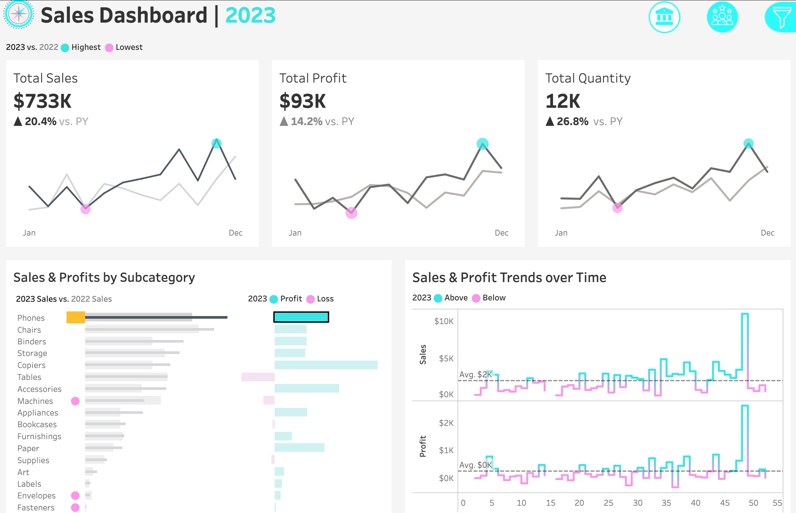
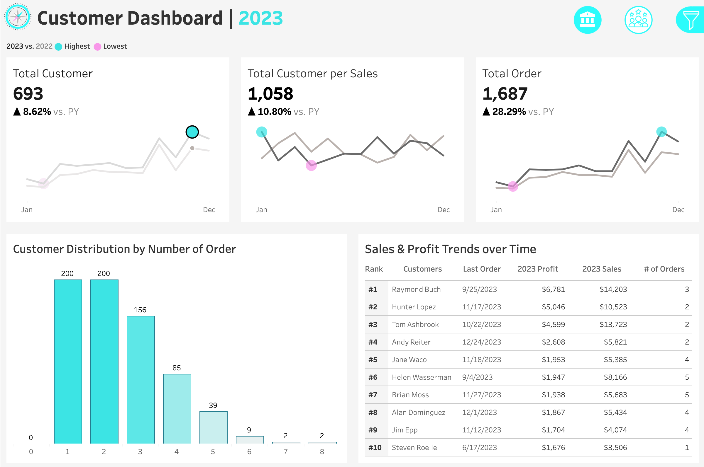

# Sales & Customer Analytics Dashboard

An interactive Tableau project featuring two dashboards designed to help
stakeholders monitor sales performance and understand customer
purchasing behavior.

## Project Overview

This project consists of two interactive dashboards designed to help
stakeholders monitor sales performance and understand customer
purchasing behavior.

### Sales Dashboard

The **Sales Dashboard** provides an overview of sales, profit, and
quantity metrics, alongside visualizations of product subcategory
performance and weekly sales and profit trends. It helps stakeholders
evaluate product performance, compare sales against profitability, and
identify notable changes in business performance over time.

### Customer Dashboard

The **Customer Dashboard** focuses on customer count, average sales per
customer, order volume, customer profitability, and order frequency.
Through customer rankings and order distribution analysis, stakeholders
can identify high-profit customers and better understand customer
purchasing activity.

Both dashboards support historical data analysis and allow users to
filter results by location and product details, enabling more focused
comparisons and exploration of business performance.

## Key Business Questions

### Sales Performance

-   How are overall sales, profits, and quantities performing?
-   Which product subcategories generate the highest sales and profits?
-   How do sales and profits change over time, and which periods require
    further investigation?

### Customer Analysis

-   What are the overall customer metrics, including customer count,
    average sales per customer, and order volume?
-   Who are the most profitable customers, and how much do they
    contribute to total profit?
-   How are customers distributed by order frequency, and what
    opportunities exist to encourage repeat purchases?

## Key Findings

### 1. Sales, Profit, and Quantity Growth

In 2023, the business generated approximately **\$733K in sales**,
**\$93K in profit**, and sold approximately **12K units**.

Compared with 2022: - Sales increased by **20.4%**. - Profit increased
by **12.5%**. - Quantity increased by **26.8%**.

The business sold more products and generated higher revenue, but profit
growth lagged behind sales and quantity growth. This suggests that
profitability did not grow as quickly as sales volume.

**Recommendation:** Investigate whether product costs, discounting, or a
shift toward lower-margin products contributed to the slower profit
growth. Further analysis is needed to identify the cause.

### 2. Product Subcategory Performance

The products generating the highest revenue are not necessarily the
products generating the highest profit. **Phones lead in sales, while
Copiers lead in profit.** Tables are a notable area of concern because
their sales do not translate into positive profit.

**Recommendation:** Investigate the cost structure, pricing, and
discounting of loss-making subcategories, particularly Tables. Also
examine what makes Copiers profitable and whether similar strategies
could be applied elsewhere.

### 3. Profit Contribution from Top Customers

The ten customers shown in the dashboard generated approximately
**\$30,119 in combined profit**. Compared with total profit of
approximately \$93K, they account for roughly **32.4% of total profit**.

This suggests that a relatively small group of customers contributes
substantially to business profitability.

**Recommendation:** Consider retention initiatives for the most
profitable customers, while investigating what distinguishes their
purchasing behavior from that of other customers.

### 4. Customer Order Frequency

A total of **556 out of 693 customers (approximately 80.2%)** placed one
to three orders.

This indicates that most customers in the dataset have placed relatively
few orders, which may present an opportunity to encourage more frequent
purchasing.

**Recommendation:** Explore targeted follow-up campaigns, relevant
product recommendations, or loyalty incentives. Measure the results to
determine whether these initiatives increase repeat purchases.

## Tools and Features

-   **Tableau Public / Tableau Desktop Public Edition**
-   Interactive sales and customer dashboards
-   Historical performance comparison (2023 vs. 2022)
-   Sales and profit analysis by product subcategory
-   Weekly sales and profit trend analysis
-   Top 10 customers ranked by profit
-   Customer distribution by number of orders
-   Filters for location and product details

## Conclusion

The dashboards provide a consolidated view of sales performance and
customer activity. The findings highlight three areas for further
business investigation: profit growth relative to sales growth, the
profitability of individual product subcategories, and opportunities to
increase customer order frequency while retaining high-profit customers.

These findings are exploratory and indicate where further analysis may
be useful; they do not establish the underlying causes of the observed
trends.

*Note: Figures are rounded as displayed in the dashboards.
Recommendations are based on the available visualizations and should be
validated with more detailed analysis before business decisions are
made.*

------------------------------------------------------------------------

## Acknowledgement

This repository was created as part of my Tableau learning journey by 
following and recreating concepts from the following tutorial:

Tableau Complete Project End-to-End https://www.youtube.com/watch?v=dahrmqT5GD4&t=7440s
